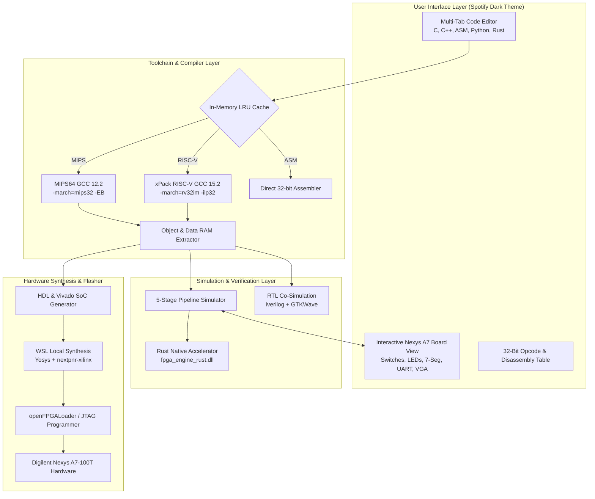

# FPGA Studio

[](https://github.com/posweeza558/fpga-studio)
[](https://digilent.com/reference/programmable-logic/nexys-a7/start)
[](https://github.com/posweeza558/fpga-studio)
[](LICENSE)

FPGA Studio is an offline Windows IDE for teaching and building 32-bit RISC CPU systems. You write a program, compile it, run it on a simulated board, synthesize the CPU, and flash both onto a Digilent Nexys A7-100T.

The editor works like VS Code, with a Spotify-style dark theme. You do not need Vivado, which takes 60 to 80 GB to install.

---

## Features

* **Two 32-bit CPU architectures**:
  * **OpenMIPS (MIPS32 Release 1)**: 5-stage pipeline, Big-Endian, Branch Delay Slot, signed/unsigned hardware multiplier & divider.
  * **RISC-V (RV32IM)**: 5-stage pipeline, Little-Endian, M-Extension (`mul`, `mulh`, `div`, `rem`), synchronous active-high reset.
* **Bundled GCC toolchains (offline)**:
  * Real `mips64-elf-gcc` (GCC 12.2.0) and `riscv-none-elf-gcc` (GCC 15.2.0-1).
  * An in-memory LRU cache, so a rebuild of unchanged source skips GCC.
  * Automatic bare-metal startup routine (`start.S`) and linker script (`link.ld`).
  * Automatic `.data` memory extraction and word-aligned BRAM initialization.
* **Languages**:
  * C / C++ (with standard bare-metal UART `printf` support).
  * Direct 32-bit Assembly (`.s` / `.asm`) with real-time bit-field disassembler.
  * Python (`.py`) & Rust (`.rs`) subset transpilation to bare-metal execution.
* **Virtual Nexys A7 board**:
  * 16 slide switches (`0xF0000004`). Click a switch to toggle it.
  * 16 user LEDs (`0xF0000000`).
  * 8-digit multiplexed 7-segment display with dynamic BCD and raw cathode decoding (`0xF0000008`).
  * 5 pushbuttons (BTNC, BTNU, BTNL, BTNR, BTND) + CPU reset latch (`0xF000000C`).
  * UART terminal at 115200 baud (`0xF0000010`).
  * 640x480 VGA framebuffer (`0xFF000000`).
* **Two simulator backends**:
  * A cycle-accurate 5-stage pipeline simulator in Python (IF, ID, EX, MEM, WB, with data forwarding and hazard detection).
  * A Rust engine (`fpga_engine_rust.dll`), called through ctypes, that runs 50 to 100 times faster (over 50M cycles per second).
* **Local synthesis without Vivado (openXC7)**:
  * Synthesize Verilog to an Artix-7 `.bit` bitstream offline, with Yosys and nextpnr-xilinx inside Windows Subsystem for Linux (WSL).
* **Flashing the board**:
  * JTAG flashing with the bundled openFPGALoader, Digilent Adept (`djtgcfg`), or Vivado in batch mode.
  * A USB-UART bootloader (`uart_prog_loader.v`) loads a new program into Block RAM on the real board in about 1 second, without a new bitstream.
* **Custom CPU import**:
  * The parser in `hdl_analyzer.py` reads your Verilog/VHDL modules, finds the bus signals (`clk`, `rst`, `addr`, `din`, `dout`, `we`), decides whether the core is a standalone ALU or a full SoC CPU, and maps its ports to the virtual board in `cpu_manifest.json`.

---

## Architecture



---

## Repository layout

```
fpga_studio/
├── config/                         # Theme styling, catalog paths, and starter templates
├── core/                           # Compiler, simulator, HDL generation, synthesis, flashing
│   ├── gcc_toolchain.py            # GCC MIPS/RISC-V integration, linker scripts & caching
│   ├── simulator_engine.py         # 5-stage pipeline simulator with MMIO bus routing
│   ├── rust_accel.py               # C-ABI bridge to Rust acceleration library
│   ├── fpga_engine_rust.dll        # Compiled Rust simulation backend
│   ├── hdl_generator.py            # Generates synthesizable VHDL/Verilog ROM & Vivado SoC
│   ├── hdl_analyzer.py             # AST parser for custom CPU port auto-inspection
│   ├── wsl_synthesis.py            # Local offline synthesis engine (Yosys + openXC7)
│   ├── fpga_programmer.py          # JTAG flasher (openFPGALoader, Adept, Vivado)
│   └── transpiler.py               # Python & Rust subset transpiler to bare-metal C
├── custom_cpus/                    # Built-in 32-bit CPU Verilog cores
│   ├── openmips/                   # OpenMIPS 32-bit core (5-stage pipeline, MULT/DIV)
│   └── riscv/                      # Synthesizable RISC-V RV32IM core
├── bitstreams/                     # Tested, ready-to-flash bitstreams for Nexys A7-100T
├── ui/                             # Tkinter UI and custom widgets
├── vscode_app.py                   # Main application entry point
├── FPGA Studio.spec                # PyInstaller packaging configuration
├── installer.iss                   # Inno Setup 6 installer compilation script
└── FPGA_Studio_System_Architecture_and_Features_Guide.md # Developer guide (Thai)
```

---

## Download

Download and run the [FPGA Studio v4.2 installer (.exe)](https://github.com/posweeza558/fpga-studio/releases/latest). It includes the GCC toolchains, bitstreams, and simulators, so it works offline.

---

## Run from source

1. Clone the repository:
   ```bash
   git clone https://github.com/posweeza558/fpga-studio.git
   cd fpga-studio
   ```
2. Install Python dependencies:
   ```bash
   pip install pyserial
   ```
3. Run the application:
   ```bash
   python vscode_app.py
   ```

---

## Developer guide

[FPGA_Studio_System_Architecture_and_Features_Guide.md](FPGA_Studio_System_Architecture_and_Features_Guide.md) is written in Thai. It covers the implementation, the RTL pipeline stages, the MMIO memory map, and how to add a new CPU or compiler.
